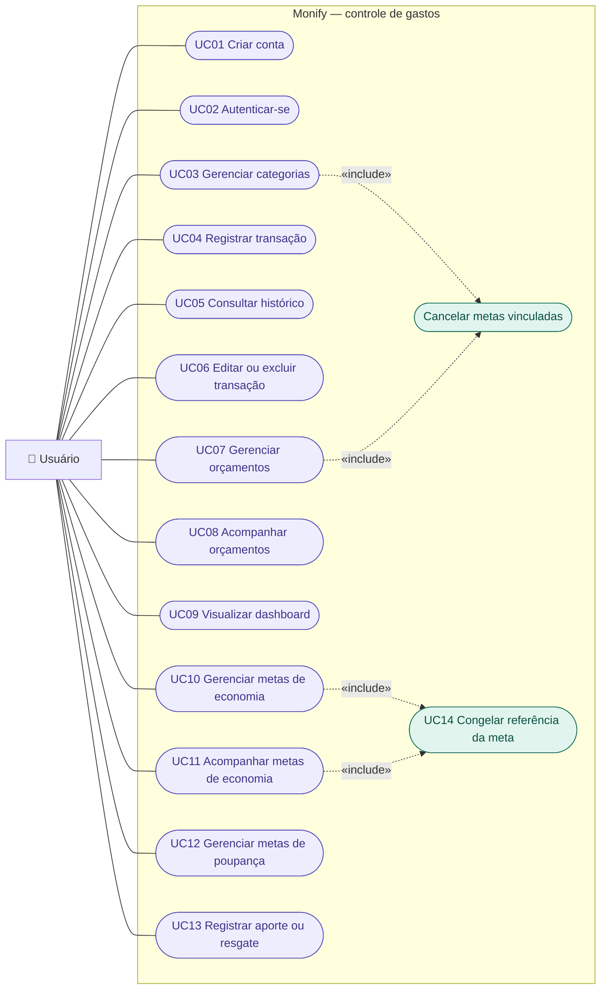
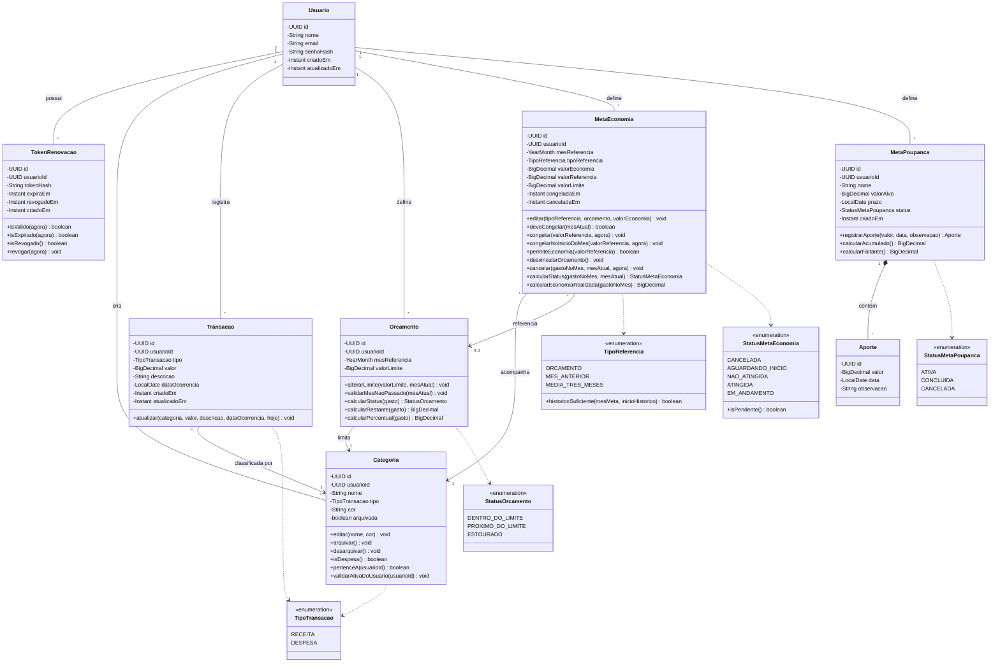

# 💰 Monify – Gestão Financeira Pessoal com Spring Boot

[](https://github.com/LindmanBassi/Monify/actions/workflows/ci.yml)

O **Monify** é uma **aplicação web de gestão financeira pessoal**, com backend em **Java 21 e Spring Boot**, frontend em **React** e deploy planejado na **AWS**. O foco do projeto está no **backend**: modelagem de domínio rica, regras de negócio testadas, persistência com **JPA/Hibernate e MySQL**, migrations versionadas com **Flyway** e testes de integração com **Testcontainers** em um banco real.

O escopo atual é o **MVP de controle de gastos**: categorias, receitas e despesas, orçamentos mensais, metas de economia, metas de poupança e dashboard.

---

## 🚧 Status do Projeto

Projeto em desenvolvimento, construído em passos pequenos, cada um compilando e com testes.

- [x] Modelo de domínio (entidades, enums e regras de negócio)
- [x] Schema do banco com Flyway
- [x] Testes unitários do domínio e testes de integração com Testcontainers
- [x] Tratamento global de erros com `ProblemDetail`
- [x] Ambiente local com Docker Compose
- [x] CI com GitHub Actions (build e testes a cada push e pull request)
- [x] Documentação da API com Swagger / OpenAPI
- [x] Autenticação (cadastro, login, JWT e refresh token com rotação)
- [x] Categorias (CRUD, arquivar e desarquivar, isolamento por usuário)
- [x] Transações (CRUD, histórico com filtros combináveis e paginação)
- [x] Orçamentos mensais (gasto, restante, percentual e status calculados no banco)
- [x] Metas de economia (referência congelada no início do mês e cancelamento automático)
- [ ] Metas de poupança e dashboard
- [ ] Frontend em React
- [ ] Deploy na AWS

---

## 🚀 Funcionalidades (MVP)

- 🔑 Autenticação & Sessão
  - Cadastro e login
  - Access token JWT de curta duração + refresh token opaco
  - Rotação de refresh token e detecção de reuso
  - Logout com revogação do token
- 🗂️ Categorias
  - Categorias padrão copiadas no cadastro do usuário
  - Tipo fixo (`RECEITA` ou `DESPESA`)
  - Remover = arquivar (o histórico permanece intacto), com opção de desarquivar
- 💸 Transações
  - Registro de receitas e despesas
  - Histórico com filtros por período, categoria, tipo e descrição, paginado
- 📊 Orçamentos
  - Limite mensal por categoria de despesa
  - Status calculado: `DENTRO_DO_LIMITE`, `PROXIMO_DO_LIMITE` (> 80%) e `ESTOURADO` (> 100%)
- 🎯 Metas de economia
  - Gastar menos em uma categoria em um mês, em relação a uma referência: orçamento, mês anterior ou média dos últimos 3 meses
  - A referência é **congelada** quando o mês da meta começa
  - Status calculado: `AGUARDANDO_INICIO`, `EM_ANDAMENTO`, `ATINGIDA`, `NAO_ATINGIDA` e `CANCELADA`
- 🐷 Metas de poupança
  - Objetivo com valor alvo e prazo opcional
  - Aportes e resgates, sem permitir acumulado negativo
  - Conclusão automática ao atingir o alvo
- 📈 Dashboard
  - Receitas, despesas e saldo do período
  - Gastos por categoria e evolução mensal
  - Tudo calculado com queries agregadas no banco

---

## 🔐 Isolamento de Dados

- O ID do usuário vem **sempre do token**, nunca do request
- Toda consulta é filtrada pelo dono do recurso
- Recurso de outro usuário responde **404**, sem revelar que ele existe
- Cada recurso terá teste de integração provando o isolamento entre usuários

---

## 🔑 Autenticação

- Senha armazenada com **BCrypt**
- **Access token** JWT assinado com HMAC (HS256), válido por 15 minutos
- **Refresh token** opaco e aleatório, válido por 7 dias; no banco fica **apenas o hash SHA-256**
- **Rotação**: cada renovação revoga o refresh token usado e emite um novo par
- **Detecção de reuso**: reutilizar um refresh token já revogado revoga todas as sessões do usuário
- Falha de login responde sempre "credenciais inválidas", sem revelar se o e-mail existe
- Erros de autenticação também seguem o formato `ProblemDetail`

| Método | Rota                  | Autenticação | Descrição                                   |
|--------|-----------------------|--------------|---------------------------------------------|
| POST   | `/api/auth/cadastro`  | —            | Cria a conta e copia as categorias padrão   |
| POST   | `/api/auth/login`     | —            | Retorna access token e refresh token        |
| POST   | `/api/auth/renovar`   | —            | Troca o refresh token por um novo par       |
| POST   | `/api/auth/logout`    | —            | Revoga o refresh token                      |
| GET    | `/api/usuarios/me`    | Bearer       | Dados do usuário autenticado                |

---

## 🗂️ Categorias

Todas as rotas exigem token e enxergam apenas as categorias do próprio usuário. Categoria de outro usuário responde **404**.

| Método | Rota                                   | Descrição                                                        |
|--------|----------------------------------------|------------------------------------------------------------------|
| GET    | `/api/categorias`                      | Lista as ativas; filtros `tipo` e `incluirArquivadas`            |
| GET    | `/api/categorias/{id}`                 | Detalhe da categoria                                             |
| POST   | `/api/categorias`                      | Cria; **409** se já existir o mesmo nome no mesmo tipo           |
| PUT    | `/api/categorias/{id}`                 | Edita nome e cor (o tipo é fixo)                                 |
| DELETE | `/api/categorias/{id}`                 | Arquiva (remover = arquivar)                                     |
| PATCH  | `/api/categorias/{id}/desarquivar`     | Volta a categoria para uso                                       |

---

## 💸 Transações

- O **tipo** (receita ou despesa) vem da categoria escolhida
- Valor positivo, com no máximo 2 casas decimais; data de hoje ou anterior (fuso de São Paulo)
- Categoria arquivada não recebe novas transações; transações antigas dela continuam editáveis
- Exclusão definitiva

| Método | Rota                       | Descrição                                                                   |
|--------|----------------------------|-----------------------------------------------------------------------------|
| GET    | `/api/transacoes`          | Histórico paginado, da mais recente para a mais antiga                      |
| GET    | `/api/transacoes/{id}`     | Detalhe da transação                                                        |
| POST   | `/api/transacoes`          | Registra a transação                                                        |
| PUT    | `/api/transacoes/{id}`     | Edita a transação                                                           |
| DELETE | `/api/transacoes/{id}`     | Exclui a transação                                                          |

Filtros combináveis do histórico: `inicio`, `fim`, `categoriaId`, `tipo` e `texto` (busca na descrição). Paginação com `page` e `size` (máximo de 100 por página), com resposta em `conteudo`, `pagina`, `tamanho`, `totalElementos` e `totalPaginas`.

---

## 📊 Orçamentos

- Limite mensal por categoria de **despesa**, um por categoria e mês
- Definido para o mês atual ou futuros; meses passados ficam como histórico
- O **gasto** do mês é somado no banco em uma única consulta agregada (`SUM ... GROUP BY`)
- Cada orçamento traz **limite, gasto, restante, percentual e status**:
  - `DENTRO_DO_LIMITE` até 80% · `PROXIMO_DO_LIMITE` até 100% · `ESTOURADO` acima de 100%
  - Restante negativo indica quanto passou do limite

| Método | Rota                          | Descrição                                                                  |
|--------|-------------------------------|----------------------------------------------------------------------------|
| GET    | `/api/orcamentos?mes=2026-10` | Orçamentos do mês (padrão: mês atual)                                      |
| GET    | `/api/orcamentos/{id}`        | Detalhe do orçamento                                                       |
| POST   | `/api/orcamentos`             | Define o orçamento: **201** ao criar, **200** ao atualizar o já existente  |
| PUT    | `/api/orcamentos/{id}`        | Altera o limite                                                            |
| DELETE | `/api/orcamentos/{id}`        | Exclui o orçamento                                                         |

---

## 🎯 Metas de economia

Gastar menos em uma categoria de despesa em um mês, em relação a uma referência escolhida pelo usuário:

- `ORCAMENTO`: o limite do orçamento da categoria no mês
- `MES_ANTERIOR`: o gasto da categoria no mês anterior
- `MEDIA_TRES_MESES`: a média do gasto nos 3 meses anteriores (meses sem gasto contam como zero)

Regras principais:

- **Congelamento**: quando o mês da meta começa, a referência é congelada e o limite passa a ser `referência − economia`. O congelamento acontece no primeiro acesso às metas no mês, sem agendador; meta criada para o mês atual já nasce congelada
- Se no congelamento a economia for maior ou igual à referência, ou a referência não puder mais ser calculada, a meta é **cancelada automaticamente**
- Antes de congelar, a meta pode ser editada; depois, só cancelada
- Status calculado: `AGUARDANDO_INICIO`, `EM_ANDAMENTO`, `NAO_ATINGIDA` (já passou do limite), `ATINGIDA` (mês terminou dentro do limite) e `CANCELADA`
- Arquivar a categoria ou excluir o orçamento vinculado **cancela automaticamente** as metas pendentes

| Método | Rota                                    | Descrição                                                    |
|--------|-----------------------------------------|--------------------------------------------------------------|
| GET    | `/api/metas-economia?mes=2026-10`       | Metas do mês com gasto, limite, economia realizada e status  |
| GET    | `/api/metas-economia/{id}`              | Detalhe da meta                                              |
| POST   | `/api/metas-economia`                   | Cria a meta (uma ativa por categoria e mês)                  |
| PUT    | `/api/metas-economia/{id}`              | Edita referência e economia antes do congelamento            |
| PATCH  | `/api/metas-economia/{id}/cancelar`     | Cancela a meta pendente                                      |

---

## 🧩 Diagramas

### Casos de Uso



- **Cancelar metas vinculadas** é incluído ao arquivar uma categoria (UC03) e ao excluir um orçamento (UC07): as metas de economia pendentes são canceladas automaticamente.
- **Congelar referência da meta** (UC14) acontece ao gerenciar ou acompanhar as metas: as metas cujo mês já começou são congeladas no primeiro acesso, sem depender de agendador.

### Classes



- `StatusOrcamento` e `StatusMetaEconomia` são **calculados**, nunca armazenados. `StatusMetaPoupanca` é armazenado.
- Saldos, gastos e acumulados **nunca são armazenados**: sempre calculados a partir das transações e aportes.

---

## 📐 Modelagem e Recursos JPA

Entidades:
- Usuario
- TokenRenovacao
- Categoria
- Transacao
- Orcamento
- MetaEconomia
- MetaPoupanca
- Aporte

Relacionamentos utilizados:
- `@ManyToOne(fetch = LAZY)` (Transacao → Categoria, Orcamento → Categoria, MetaEconomia → Categoria / Orcamento)
- **Specifications** do Spring Data para os filtros combináveis do histórico, com `@EntityGraph` para carregar a categoria sem N+1
- `@OneToMany` com `cascade = ALL` e `orphanRemoval` (MetaPoupanca → Aporte, composição)
- Entidades referenciam o dono por `usuarioId`, com chave estrangeira no banco

Outros recursos utilizados:
- **Entidades ricas**: regras de negócio nos métodos de domínio, sem `@Setter`, testáveis sem Spring nem banco
- IDs **UUID v7** (ordenados por tempo) gerados pelo Hibernate e armazenados como `BINARY(16)`
- `AttributeConverter` para gravar `YearMonth` como `DATE` (dia 1)
- Valores monetários sempre em `BigDecimal` / `DECIMAL(19,2)`
- Enums em `@Enumerated(EnumType.STRING)`
- **Coluna gerada** no MySQL para garantir uma única meta de economia ativa por categoria e mês (o MySQL não suporta índice parcial)
- `ddl-auto=validate`: o schema é controlado apenas pelo Flyway

---

## 🗂️ Arquitetura

API REST no padrão MVC, com pacotes por camada:

```
br.com.bassi.monify
├── config/        → segurança, OpenAPI, Clock
├── controller/    → endpoints REST
├── service/       → orquestração dos casos de uso
├── repository/    → Spring Data JPA
├── domain/        → entidades com regras de negócio
│   ├── enums/
│   └── converter/
├── dto/           → records de request/response
├── exception/     → exceções de negócio
├── handler/       → tratamento global de erros
└── util/          → utilitários (ex.: Dinheiro)
```

---

## ⚠️ Tratamento de Erros

Erros padronizados no formato **`ProblemDetail` (RFC 9457)**, centralizados em um `@RestControllerAdvice`.

- Hierarquia de exceções com `MonifyException`, em que cada exceção define seu próprio `ProblemDetail`
- `400` para erros de validação, com a lista de `campos-invalidos`
- `401` para requisições não autenticadas
- `404` para recurso inexistente ou de outro usuário
- `409` para conflitos de unicidade
- `422` para violações de regra de negócio

---

## 🧪 Testes

- **Unitários** das regras de domínio (status de metas, congelamento, orçamentos, aportes), sem Spring nem banco
- **Unitários** dos services com Mockito (cadastro, login, rotação e reuso de refresh token)
- **Integração** com **Testcontainers**, em um MySQL real: mapeamento das entidades, constraints, migrations e fluxos da API
- **Segurança**: token ausente, malformado, expirado ou assinado com outro segredo, rotação e reuso de refresh token
- Padrão: `@Nested` por método, `@DisplayName` em português e estrutura Arrange / Act / Assert

```bash
./mvnw test
```

> 🐳 Os testes de integração precisam do Docker em execução.

---

## 🛠️ Tecnologias Utilizadas

- Java 21
- Spring Boot 4
- Spring Data JPA / Hibernate 7
- Spring Security + OAuth2 Resource Server (JWT com `NimbusJwtEncoder` / `NimbusJwtDecoder`)
- Bean Validation
- Swagger / OpenAPI (springdoc)
- MySQL 8.4
- Flyway
- Docker & Docker Compose
- JUnit 5, Mockito e Testcontainers
- Lombok
- Maven
- GitHub Actions

Planejadas nas próximas etapas:
- React, TypeScript, Tailwind CSS e Recharts
- AWS

---

## ⚙️ Requisitos para rodar o projeto

- JDK 21
- Docker e Docker Compose

O projeto já possui um `docker-compose.yml` que sobe o MySQL com o banco `monify` na porta **3307**. As tabelas são criadas automaticamente pelo Flyway quando a aplicação inicia.

A configuração pode ser ajustada por variáveis de ambiente:

| Variável      | Padrão                                | Descrição                                  |
|---------------|---------------------------------------|--------------------------------------------|
| `DB_URL`      | `jdbc:mysql://localhost:3307/monify`  | URL do banco                               |
| `DB_USERNAME` | `monify`                              | Usuário do banco                           |
| `DB_PASSWORD` | `monify`                              | Senha do banco                             |
| `JWT_SEGREDO` | segredo local de desenvolvimento      | Segredo HMAC do JWT (mínimo de 32 bytes)   |

> ⚠️ Os valores padrão servem apenas para o ambiente local. Em produção, `JWT_SEGREDO` deve ser um segredo forte e exclusivo.

---

## 🚀 Como rodar

### 1️⃣ Subir o banco de dados com Docker

```bash
docker compose up -d
```

### 2️⃣ Rodar a aplicação Spring Boot

Com o JDK 21 configurado:

```bash
./mvnw spring-boot:run
```

Ou rode diretamente pela sua IDE (ex: IntelliJ IDEA).

### 3️⃣ Testar pelo Swagger

Acesse **http://localhost:8080/swagger-ui.html**.

1. Crie uma conta em `POST /api/auth/cadastro`
2. Faça login em `POST /api/auth/login` e copie o `tokenAcesso`
3. Clique em **Authorize**, cole o token e teste as rotas protegidas

---

Desenvolvido por Henrique Lindman ✨
